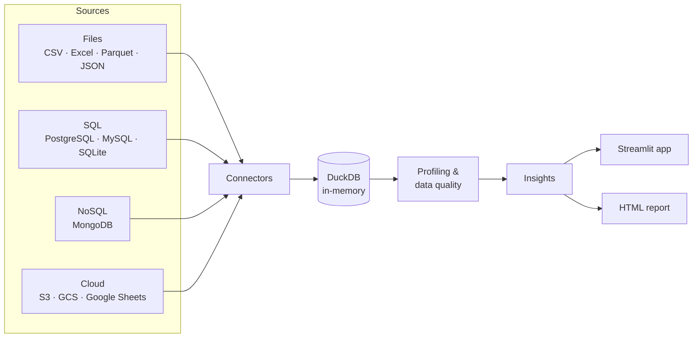

<div align="center">

# 🔨 insights-forge

**Connect any data source and get automatic data-quality reports, profiling and insights.**

[](https://github.com/JuanAvendan/insights-forge/actions/workflows/ci.yml)

[](https://github.com/astral-sh/uv)
[](https://github.com/astral-sh/ruff)
[](https://mypy-lang.org/)
[](LICENSE)

🇺🇸 English · [🇪🇸 Español](README.es.md)

</div>

---

> 🚧 **Work in progress.** Files → profiling → data quality → insights → HTML report works end to end. SQL, NoSQL and cloud sources are next. See the [roadmap](#roadmap).

## Why

Every analysis starts the same way: load the data, check what's broken, understand its shape.
**insights-forge** automates that first hour. Point it at a file, a SQL database, a NoSQL
collection or cloud storage, and it tells you what's in there and what's wrong with it.

## Features

- **Many sources, one engine.** Every source is loaded into an in-memory [DuckDB](https://duckdb.org/) table, so the analysis code is written once and works everywhere.
- **Smart file loading.** CSV/TSV with automatic delimiter, header and type detection, plus Excel (any sheet), Parquet and JSON.
- **Column profiling.** Type-aware statistics computed in SQL inside DuckDB: quartiles, mean, standard deviation, zeros, negatives, text lengths, date ranges and top values.
- **Data-quality checks.** Each finding gets a severity and the number of affected rows:

  | Check | Example finding |
  |---|---|
  | Duplicate rows | *12 duplicate rows (1.2% of the data)* |
  | Duplicate identifiers | *`order_id` looks like an identifier but 12 values are repeated* |
  | Missing values / empty columns | *50 missing values (4.9%)* |
  | Suspicious negatives | *3 negative values in an otherwise positive column* |
  | Extreme outliers (Tukey IQR fences) | *11 extreme values outside [-11, 17]* |
  | Constant columns | *every value is identical* |
  | Text hygiene | blank strings, untrimmed spaces, numbers or dates stored as text |

- **Correlations.** Pearson matrix across numeric columns, with the notable relationships listed.
- **Interactive web app.** Streamlit + Plotly: overview, filterable issue list, per-column explorer (with an outlier-hiding zoom) and a correlation heatmap. Chart colors come from a colorblind-safe palette with separate light and dark steps.
- **Automatic insights.** Ranked, plain-language findings, for example:
  - *"Laptop accounts for 66% of total. The top 2 of 7 products make up 80%."*
  - *"May 2025 was the strongest month (+228%). A single row contributes 88% of that month: check it is not an outlier."*
  - *"Duplicate rows inflate total by 5.2%."*

  The engine detects the **measure**, **date** and **dimension** columns automatically (English and Spanish names) and picks sum or average by meaning. It covers trends (least-squares fit with R², ignoring incomplete trailing periods), peaks, concentration and Pareto, segment gaps, skew, correlations and the impact of duplicates.
- **Shareable HTML report.** One self-contained file with insights, trend chart, data-quality table, column summary and correlations, in light and dark mode. Use `--offline` to embed plotly.js.
- **Command-line interface.** `insights-forge summary` and `insights-forge report`.

## Architecture



Each connector implements a single method, `read(con) -> DuckDBPyRelation`. The base class
materializes the result into a DuckDB table, so the data stays available after a temporary
file is deleted or a database connection closes.

## Quickstart

Requires [uv](https://docs.astral.sh/uv/getting-started/installation/).

```bash
git clone https://github.com/JuanAvendan/insights-forge.git
cd insights-forge
uv sync
uv run streamlit run src/insights_forge/app/streamlit_app.py
```

Then upload a file, or click **Try with sample data** in the sidebar.

### From the command line

```bash
uv run insights-forge summary data/sample/sales.csv              # issues + insights in the terminal
uv run insights-forge report data/sample/sales.csv -o report.html
uv run insights-forge report sales.xlsx --sheet Data --measure revenue --date-column day
```

### As a library

```python
from pathlib import Path

import duckdb
from insights_forge.connectors import FileConnector

from insights_forge.insights import generate_insights
from insights_forge.profiling import profile_table

con = duckdb.connect()
FileConnector(Path("data/sample/sales.csv")).load(con, table_name="sales")

profile = profile_table(con, "sales")
print(f"{profile.rows:,} rows, {profile.completeness_pct:.1f}% complete")
for issue in profile.issues:
    print(f"[{issue.severity}] {issue.column or 'table'}: {issue.message}")

report = generate_insights(con, profile)  # or measure="quantity", date="order_date"
for insight in report.insights[:3]:
    print(insight.title)
```

Or the whole pipeline in one call: `insights_forge.pipeline.analyze_file(path)`.

## Roadmap

- [x] **v0.1: Foundations.** Project setup, CI, connector architecture, file connector, basic UI
- [x] **v0.2: Profiling.** Column statistics, data-quality checks, distributions and correlations
- [x] **v0.3: Insights.** Rule-based findings in plain language, time-series trends, HTML report export, CLI
- [ ] **Live demo** on Streamlit Community Cloud
- [ ] **v0.4: SQL sources.** PostgreSQL, MySQL, SQLite (Docker Compose for local test databases)
- [ ] **v0.5: NoSQL & cloud.** MongoDB, S3 / GCS, Google Sheets
- [ ] **v0.6: AI insights.** Optional LLM-generated summaries of the profile

## Tech stack

| Area | Tools |
|---|---|
| Data engine | DuckDB, Polars, PyArrow, fastexcel |
| App, charts & report | Streamlit, Plotly, Jinja2 |
| Tooling | uv, Ruff, mypy (strict), pytest + coverage, pre-commit |
| CI | GitHub Actions (Linux + Windows, Python 3.12 / 3.13) |

## Development

```bash
uv sync                          # install everything, including dev tools
uv run pre-commit install        # run lint, format and type checks on every commit
uv run pytest                    # tests + coverage
uv run ruff check . && uv run mypy
```

### Project structure

```
insights-forge/
├── src/insights_forge/
│   ├── connectors/       # one module per source type
│   ├── profiling/        # statistics (SQL in DuckDB) and data-quality checks
│   ├── insights/         # role detection and rule-based insight generators
│   ├── report/           # Jinja2 HTML report
│   ├── app/              # Streamlit UI
│   ├── charts.py         # Plotly figures shared by the app and the report
│   ├── pipeline.py       # load -> profile -> insights in one call
│   └── cli.py            # `insights-forge` command
├── tests/
├── scripts/              # utilities (e.g. sample data generator)
└── data/sample/          # small synthetic datasets (real data is git-ignored)
```

## License

[MIT](LICENSE) © Juan Avendaño
