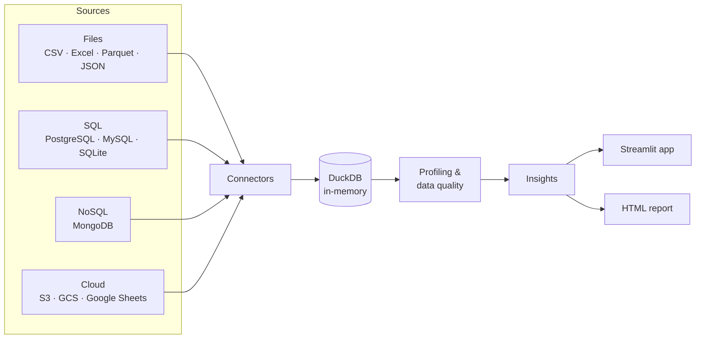

<div align="center">

# 🔨 insights-forge

**Connect any data source and get automatic data-quality reports, profiling and insights.**

[](https://github.com/JuanAvendan/insights-forge/actions/workflows/ci.yml)

[](https://github.com/astral-sh/uv)
[](https://github.com/astral-sh/ruff)
[](https://mypy-lang.org/)
[](LICENSE)

🇺🇸 English · [🇪🇸 Español](README.es.md)

</div>

---

> 🚧 **Work in progress.** File loading (CSV, Excel, Parquet, JSON) is ready; automatic profiling and insights are next. See the [roadmap](#roadmap).

## Why

Every analysis starts the same way: load the data, check what's broken, understand its shape.
**insights-forge** automates that first hour. Point it at a file, a SQL database, a NoSQL
collection or cloud storage, and it tells you what's in there and what's wrong with it.

## Features

- **Many sources, one engine.** Every source is loaded into an in-memory [DuckDB](https://duckdb.org/) table, so the analysis code is written once and works everywhere.
- **Smart file loading.** CSV/TSV with automatic delimiter, header and type detection, plus Excel (any sheet), Parquet and JSON.
- **Data-quality report** *(next)*. Missing values, duplicates, outliers, invalid values and type issues.
- **Automatic insights** *(next)*. Distributions, correlations, trends over time and plain-language findings.
- **Interactive web app.** Built with Streamlit and Plotly.

## Architecture



Each connector implements a single method, `read(con) -> DuckDBPyRelation`. The base class
materializes the result into a DuckDB table, so the data stays available after a temporary
file is deleted or a database connection closes.

## Quickstart

Requires [uv](https://docs.astral.sh/uv/getting-started/installation/).

```bash
git clone https://github.com/JuanAvendan/insights-forge.git
cd insights-forge
uv sync
uv run streamlit run src/insights_forge/app/streamlit_app.py
```

Then upload a file, or click **Try with sample data** in the sidebar.

### As a library

```python
from pathlib import Path

import duckdb
from insights_forge.connectors import FileConnector

con = duckdb.connect()
sales = FileConnector(Path("data/sample/sales.csv")).load(con, table_name="sales")
print(sales.shape)
print(con.sql("SELECT region, SUM(total) FROM sales GROUP BY ALL").fetchall())
```

## Roadmap

- [x] **v0.1: Foundations.** Project setup, CI, connector architecture, file connector, basic UI
- [ ] **v0.2: Profiling.** Column statistics, data-quality checks, distributions and correlations
- [ ] **v0.3: Insights.** Rule-based findings in plain language, time-series trends, HTML report export, live demo
- [ ] **v0.4: SQL sources.** PostgreSQL, MySQL, SQLite (Docker Compose for local test databases)
- [ ] **v0.5: NoSQL & cloud.** MongoDB, S3 / GCS, Google Sheets
- [ ] **v0.6: AI insights.** Optional LLM-generated summaries of the profile

## Tech stack

| Area | Tools |
|---|---|
| Data engine | DuckDB, Polars, PyArrow, fastexcel |
| App & charts | Streamlit, Plotly |
| Tooling | uv, Ruff, mypy (strict), pytest + coverage, pre-commit |
| CI | GitHub Actions (Linux + Windows, Python 3.12 / 3.13) |

## Development

```bash
uv sync                          # install everything, including dev tools
uv run pre-commit install        # run lint, format and type checks on every commit
uv run pytest                    # tests + coverage
uv run ruff check . && uv run mypy
```

### Project structure

```
insights-forge/
├── src/insights_forge/
│   ├── connectors/       # one module per source type
│   └── app/              # Streamlit UI
├── tests/
├── scripts/              # utilities (e.g. sample data generator)
└── data/sample/          # small synthetic datasets (real data is git-ignored)
```

## License

[MIT](LICENSE) © Juan Avendaño
